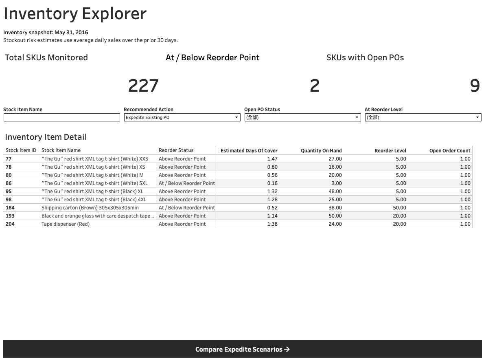
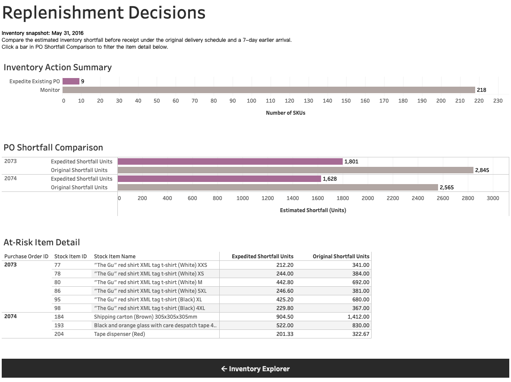

# WideWorldImporters Inventory Explorer

**MySQL 8 · Tableau Public · Inventory snapshot as of May 31, 2016**

[Open the interactive Tableau dashboard](https://public.tableau.com/app/profile/pei.chun.huang/viz/WideWorldImportersInventoryExplorerReplenishmentDecisions2016-05-31/InventoryExplorer)

## Project Overview

I built a MySQL 8 workflow and an interactive Tableau dashboard to help buyers prioritize replenishment for 227 SKUs. The analysis combines a May 31, 2016 inventory snapshot, outstanding purchase orders, and 30 days of recorded sales outflow. It generates an item-level action list and models how moving an expected receipt seven days earlier changes the estimated inventory shortfall.

## Business Questions

A buyer needs to know whether available stock will last until the next delivery and what to do if it falls short. Reacting to the reorder point alone can lead to duplicate orders when stock is already on the way. Waiting for an existing order can also leave an item short if the expected delivery is too far away.

- Which items are at or below their reorder level?
- Will current inventory last until the earliest expected receipt?
- When should a buyer expedite, review a reorder, or continue monitoring?

## Key Findings and Decision Rules

I started with an inventory watchlist in SQL by flagging items whose on-hand quantity was at or below their reorder level. I then joined each item to its outstanding purchase orders and compared estimated days of cover with the days until the earliest expected delivery. For items without an open purchase order, I checked the reorder threshold and compared coverage with the product's replenishment lead time.

- **Expedite an existing order** when estimated coverage falls short of the time to a valid upcoming receipt. Use estimated shortfall units to prioritize supplier follow-up.
- **Review replenishment for items without an open order** when they meet the reorder threshold or, with a valid lead time and recent sales, when coverage runs out before a new order could arrive.
- **Verify the purchase order first** when its expected date is missing or past due. A reliable receipt date is needed to assess coverage.

### Expedite scenario for a shipping carton

The May 31 snapshot flagged nine distinct SKUs across two purchase orders for expedite review. SKU 184, a brown shipping carton, had 38 units on hand and averaged 72.5 units of daily sales outflow. On-hand inventory covered about half a day, while PO 2074 was due in 20 days.

| Scenario | Expected receipt | Wait from snapshot | Projected shortfall before receipt |
| --- | --- | ---: | ---: |
| Original schedule | June 20, 2016 | 20 days | 1,412 units |
| Seven days earlier | June 13, 2016 | 13 days | 904.5 units |

Moving the receipt seven days earlier reduced the modeled pre-receipt shortfall by 507.5 units (35.9%). The remaining gap gives the buyer a reason to discuss a partial shipment arriving sooner or another source of interim supply alongside the expedite request.

## Business Implications

The reorder threshold, existing supply, and receipt timing answer different questions. An item below its reorder level may already have enough coverage to reach its next delivery. An item above the threshold can still warrant early review if it has no open order and its coverage is shorter than its lead time. For items that warrant expediting, the remaining shortfall under the earlier ETA shows whether the modeled expedite would fully close the gap or leave a need for more supply.

The workflow delivers an item-level action list and a purchase-order scenario export for buyer review. A buyer can use the estimated shortfall to prioritize supplier follow-up and compare the potential benefit of a faster delivery with the effort or cost of expediting. An uncovered gap can put customer orders at risk. Expediting can add freight or supplier fees.

The project reports modeled unit shortfalls using sample data. Revenue impact, expedite costs, and buyer adoption were outside the measured scope.

## Data Sources

The project uses an imported subset of the [WideWorldImporters sample database](https://github.com/microsoft/sql-server-samples/tree/master/samples/databases/wide-world-importers). The counts below are the expected clean-table counts documented in the SQL setup.

| Table | Expected rows |
| --- | ---: |
| Stock items | 227 |
| Inventory holdings | 227 |
| Suppliers | 13 |
| Purchase orders | 2,074 |
| Purchase order lines | 8,367 |

The analysis uses a May 31, 2016 inventory snapshot and a 30-calendar-day sales window. The purchase order counts describe the input tables. The action rules use only qualifying open orders and lines.

## Data and Methodology

| Script | What it does |
| --- | --- |
| [01 — Structured data audit](sql/01_structured_data_audit.sql) | Checks key uniqueness, field formats, and relationships across the source tables. |
| [02 — Clean tables](sql/02_create_clean_tables.sql) | Loads typed MySQL tables and validates row counts, key relationships, and transformed values. |
| [03 — Inventory risk and open purchase orders](sql/03_inventory_risk_analysis.sql) | Produces one row per item, flags reorder status, and summarizes outstanding quantities and earliest expected delivery. Outstanding packages are converted to units when the product master supports a reliable conversion. |
| [04 — Inventory coverage and expedite scenarios](sql/04_inventory_coverage_analysis_final.sql) | Aggregates recent sales outflow by item, classifies the next action, and models what happens when the earliest expected receipt moves seven days earlier, with the snapshot date as the earliest possible date. |

### Metrics and decision rationale

| Metric | Definition | Decision it supports |
| --- | --- | --- |
| At or below reorder level | On-hand units ≤ item reorder level | Identifies items that meet the replenishment threshold. |
| Open purchase orders and earliest ETA | Counts unfinalized orders with unfinalized lines that still have quantity due and takes the earliest available expected delivery date | Shows whether replenishment is already in progress and when the first receipt is expected. |
| Average daily sales outflow | Units from type-10 transactions from May 2 through May 31, divided by 30 calendar days | Puts recent inventory consumption on a daily basis. |
| Estimated days of cover | On-hand units ÷ average daily sales outflow, when the denominator is nonzero | Estimates how long current stock can support recent sales. |
| Estimated shortfall before receipt | The greater of zero or estimated demand through the expected receipt date minus on-hand units | Expresses the potential gap in units so buyers can prioritize follow-up. |
| Estimated shortfall reduction | Original estimated shortfall minus the estimate under the earlier-delivery scenario | Shows how much of the potential gap a seven-day expedite could close. |

## Tableau Dashboard

Use Inventory Explorer to review the inventory snapshot and replenishment decisions for individual items.

[Explore the interactive Tableau dashboard](https://public.tableau.com/app/profile/pei.chun.huang/viz/WideWorldImportersInventoryExplorerReplenishmentDecisions2016-05-31/InventoryExplorer)




## Repository Structure

```text
inventory-replenishment-analysis/
├── data/
│   └── processed/
│       ├── inventory_risk_snapshot_2016-05-31.csv
│       ├── inventory_action_list.csv
│       └── po_expedite_scenarios.csv
├── images/
│   ├── inventory_explorer.png
│   └── po_expedite_scenarios.png
├── sql/
│   ├── 01_structured_data_audit.sql
│   ├── 02_create_clean_tables.sql
│   ├── 03_inventory_risk_analysis.sql
│   └── 04_inventory_coverage_analysis_final.sql
├── .gitignore
└── README.md
```

## Reproduce the Analysis

1. In MySQL 8, use the `inventory_ops` schema. The scripts expect six preloaded raw tables. The first five come from `Warehouse.StockItems`, `Warehouse.StockItemHoldings`, `Purchasing.Suppliers`, `Purchasing.PurchaseOrders`, and `Purchasing.PurchaseOrderLines`, loaded as `raw_stock_items`, `raw_stock_item_holdings`, `raw_suppliers`, `raw_purchase_orders`, and `raw_purchase_order_lines`. Load `Warehouse.StockItemTransactions` as `raw_stock_item_transactions` for script 04. Use the column names referenced in the SQL and the same source extracts to reproduce the snapshot counts.
2. Run scripts 01 through 04 in order. Use the audit output and clean-table validation queries to check the loaded data.
3. Export the main result from script 03 as `inventory_risk_snapshot_2016-05-31.csv`. Export the two result sets from script 04 as `inventory_action_list.csv` and `po_expedite_scenarios.csv`.
4. Open the Tableau Public dashboard linked above to explore the published results.

## Limitations

The SQL treats recent average sales outflow as a constant rate. It estimates risk up to the earliest expected receipt using the imported snapshot and does not reconstruct historical purchase order states or validate actual future stockouts.

## Tools

MySQL 8 and Tableau Public

## Author

Pei-Chun Huang  
MS in Business Analytics, University of Washington Foster School of Business
